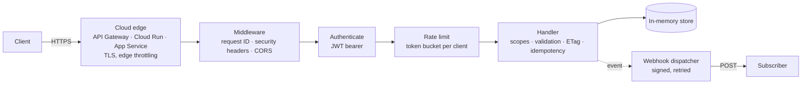

# 27 API concepts, built three times

[](https://github.com/abdulhathi/api-concepts-three-stacks/actions/workflows/ci.yml)

One small **Bookshop API** that puts every core API concept into working, tested code: authentication, OAuth 2.0,
JWT, CORS, pagination, caching, rate limiting, throttling, idempotency, retries with backoff, webhooks, GraphQL and
RFC 9457 errors. It is built three times, once in each stack and cloud:

| Stack | Cloud target | Folder | Own tests |
|---|---|---|---|
| **Python · FastAPI** | AWS Lambda + API Gateway (SAM) | [`python-fastapi-aws/`](python-fastapi-aws/) | 116 |
| **TypeScript · Node.js · Express 5** | Google Cloud Run | [`node-typescript-gcp/`](node-typescript-gcp/) | 81 |
| **C# · .NET 9 Minimal APIs** | Azure App Service (Bicep) | [`dotnet-azure/`](dotnet-azure/) | 75 |

All three follow one written contract, [`SPEC.md`](SPEC.md), and one black-box test suite,
[`contract-tests/`](contract-tests/), proves it: the same 59 HTTP tests pass against every server.

**Learn it:** [`tutorial-app/`](tutorial-app/) is the **API Concepts Lab**, a course built on this code. Each concept
has a narrated video with animated diagrams (about 11 minutes, 27 in all), the concept guide, and a practice lab that
sends real requests to the three running servers, checks the answers, opens the code that handled them, and ends with
a change to build yourself.

## The 27 concepts

Each guide explains the concept, shows the real code from all three stacks side by side, and ends with curl commands,
common mistakes and interview questions.

| # | Concept | What the API does |
|---|---|---|
| 1 | [Requests and responses](docs/concepts/01-requests-and-responses.md) | `/v1/echo` shows exactly what the server received; one JSON log line per request |
| 2 | [Endpoints](docs/concepts/02-endpoints.md) | resource routes under `/v1` |
| 3 | [HTTP methods](docs/concepts/03-http-methods.md) | GET, POST, PUT, PATCH and DELETE on products |
| 4 | [Headers](docs/concepts/04-headers.md) | `X-Request-Id` tracing, 415 on the wrong `Content-Type`, `Location`, security headers |
| 5 | [Path and query parameters](docs/concepts/05-path-and-query-parameters.md) | `/v1/products/{id}`, `?limit&cursor&tag` with validation |
| 6 | [Request bodies](docs/concepts/06-request-bodies.md) | validated JSON bodies, field-level errors |
| 7 | [JSON and serialization](docs/concepts/07-json-and-serialization.md) | camelCase, integer cents, RFC 3339 UTC timestamps |
| 8 | [API schemas](docs/concepts/08-api-schemas.md) | OpenAPI 3 at `/openapi.json`, interactive docs at `/docs` |
| 9 | [Status codes](docs/concepts/09-status-codes.md) | 200 201 204 304 400 401 403 404 409 412 415 422 429 500 503 504 |
| 10 | [Authentication](docs/concepts/10-authentication.md) | bearer tokens, 401 with a `WWW-Authenticate` challenge |
| 11 | [Authorization](docs/concepts/11-authorization.md) | scopes (403) and ownership (another client's order is a 404) |
| 12 | [Access tokens and JWT](docs/concepts/12-access-tokens-and-jwt.md) | HS256 JWT with `iss aud sub scope exp jti`, strict validation |
| 13 | [OAuth 2.0](docs/concepts/13-oauth2.md) | client credentials grant, Basic and form client auth, scope narrowing |
| 14 | [HTTPS](docs/concepts/14-https.md) | HSTS behind a TLS-terminating proxy; TLS at the cloud edge |
| 15 | [CORS](docs/concepts/15-cors.md) | origin allowlist, preflight, exposed headers |
| 16 | [REST](docs/concepts/16-rest.md) | resources, uniform interface, `Location` and `Link` |
| 17 | [GraphQL](docs/concepts/17-graphql.md) | an order and its products in one round trip; field-level authorization |
| 18 | [Pagination](docs/concepts/18-pagination.md) | opaque cursors, a `page` object and a `Link: rel="next"` header |
| 19 | [Caching](docs/concepts/19-caching.md) | `ETag`, `If-None-Match` → 304, `Cache-Control`, `If-Match` → 412 |
| 20 | [Rate limiting](docs/concepts/20-rate-limiting.md) | token bucket per client plan, 429 with `Retry-After` and `RateLimit-*` |
| 21 | [Throttling](docs/concepts/21-throttling.md) | 2 running + 2 queued on a slow endpoint, 503 beyond that |
| 22 | [Idempotency](docs/concepts/22-idempotency.md) | `Idempotency-Key` on order creation: replay, reuse and in-flight rules |
| 23 | [Retries](docs/concepts/23-retries.md) | a typed client that retries only what is safe to retry |
| 24 | [Timeouts](docs/concepts/24-timeouts.md) | a 504 server deadline and a per-attempt client timeout |
| 25 | [Exponential backoff](docs/concepts/25-exponential-backoff.md) | capped, jittered delays that honour `Retry-After` |
| 26 | [Webhooks](docs/concepts/26-webhooks.md) | HMAC-signed deliveries, retries with backoff, a delivery log |
| 27 | [Error handling](docs/concepts/27-error-handling.md) | RFC 9457 `application/problem+json` for every error, no leaked internals |

Each stack's `CONCEPTS.md` maps the same 27 concepts to exact files, lines and tests:
[Python](python-fastapi-aws/CONCEPTS.md) · [TypeScript](node-typescript-gcp/CONCEPTS.md) ·
[C#](dotnet-azure/CONCEPTS.md).

## How a request flows



## Run it

Each stack runs with no database, no Docker and no cloud account; data is seeded in memory on start.

```bash
# Python · FastAPI on :8001
cd python-fastapi-aws && python3 -m venv .venv && .venv/bin/pip install -e ".[dev]"
.venv/bin/python -m app

# TypeScript · Express on :8002
cd node-typescript-gcp && npm install && npm run dev

# C# · ASP.NET Core on :8003
cd dotnet-azure && dotnet run --project src/ApiConcepts.Api
```

Then, against any of them:

```bash
TOKEN=$(curl -s -u reader:reader-secret -d grant_type=client_credentials \
  http://localhost:8001/oauth/token | jq -r .access_token)
curl -s -H "Authorization: Bearer $TOKEN" "http://localhost:8001/v1/products?limit=3" | jq
```

Interactive docs: `http://localhost:<port>/docs`. The demo OAuth clients (`reader`, `writer`, `partner`, `admin`,
`free`) and their scopes are listed in [`SPEC.md`](SPEC.md#demo-oauth-clients-dev-only-documented-as-such); they exist
for local learning only.

## Test it

```bash
cd python-fastapi-aws && .venv/bin/pytest          # 116 tests
cd node-typescript-gcp && npm test                 # 81 tests
cd dotnet-azure && dotnet test                     # 75 tests

cd contract-tests && npm install
./run.sh python && ./run.sh node && ./run.sh dotnet   # the same 59 tests against each server
```

[GitHub Actions](.github/workflows/ci.yml) runs every stack's tests, the contract suite and the lab's tests on each push.

## Deploy it

Each stack ships infrastructure as code for its cloud; the stack READMEs walk through the commands.

| Cloud | What gets created | Files |
|---|---|---|
| AWS | Lambda (via Mangum) behind an API Gateway HTTP API with stage throttling, the JWT secret in SSM Parameter Store, CloudWatch log retention | [`infra/aws/`](python-fastapi-aws/infra/aws/) |
| GCP | Container image in Artifact Registry, a Cloud Run service, the JWT secret in Secret Manager | [`infra/gcp/`](node-typescript-gcp/infra/gcp/), [`Dockerfile`](node-typescript-gcp/Dockerfile) |
| Azure | App Service on Linux with HTTPS only, the JWT secret in Key Vault through a managed identity, Application Insights | [`infra/azure/`](dotnet-azure/infra/azure/) |

## Design decisions

- **Contract first.** `SPEC.md` was written before any code, and the contract suite treats every server as a black
  box. Three frameworks, one observable behaviour.
- **Concepts stay visible.** Where a framework has a built-in (ASP.NET Core's rate limiter, RequestTimeouts and
  ProblemDetails), the .NET stack uses it; the TypeScript stack hand-writes the token bucket, throttle queue and
  idempotency store so the mechanics are easy to read.
- **Errors are a contract too.** Every failure is an RFC 9457 problem with a stable `type`, the request ID and, for
  validation, field-level errors. 500s never leak stack traces.
- **Honest about production.** State lives in memory per instance. Each stack's README names what replaces it in its
  cloud: DynamoDB, Firestore or Cosmos DB for data; ElastiCache, Memorystore or Azure Cache for Redis for shared rate
  limit and idempotency state; SQS, Cloud Tasks or Service Bus for webhook delivery; Cognito, Identity Platform or
  Entra ID instead of the demo clients.

## Repository layout

```text
SPEC.md                  the HTTP contract all three stacks implement
docs/concepts/           27 concept guides with side-by-side code
python-fastapi-aws/      FastAPI app, typed client, pytest suite, AWS SAM template
node-typescript-gcp/     Express 5 app, typed client, Vitest suite, Dockerfile, Cloud Run scripts
dotnet-azure/            Minimal API app, typed client, xUnit suite, Bicep template
contract-tests/          one black-box suite run against every server
tutorial-app/            the API Concepts Lab: videos, guides and live practice for all 27 concepts
```

## Credits

The concept list follows the video
[25+ API Concepts Every Developer Must Know](https://www.youtube.com/watch?v=5U7LwO-eyBg) by Codist. The code, contract
and guides here are my own.

## License

[MIT](LICENSE) © Abdul Hathi Mohamed Hussain
