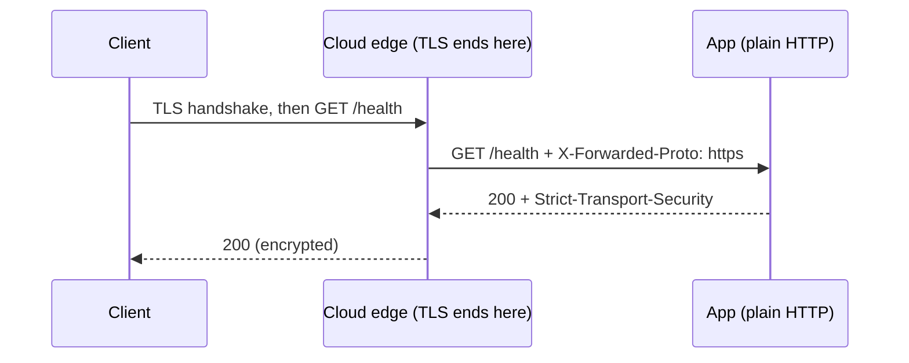

# 14 · HTTPS

HTTPS is HTTP sent over TLS, which encrypts the connection and proves the server is who it says it is.

## Why it matters

- Bearer tokens and request bodies cross networks you do not control. Over plain HTTP, anyone on the path can read or change them.
- A token read from the wire works for anyone until it expires, because a bearer token has no other proof of identity.
- Without HSTS, a browser can be tricked into a first plain-HTTP request that an attacker intercepts.

## How it works

TLS sets up an encrypted channel before any HTTP is sent. In the cloud, the platform's front end (API Gateway, Cloud Run, App Service) ends TLS and forwards plain HTTP to your app on a private hop. It adds `X-Forwarded-Proto: https` so the app still knows the client's original scheme.



HSTS (RFC 6797) tells a browser: use HTTPS only for this host for the next year.

```http
HTTP/1.1 200 OK
Strict-Transport-Security: max-age=31536000; includeSubDomains
X-Content-Type-Options: nosniff
Referrer-Policy: no-referrer
```

## The rule in this repo

- The apps speak plain HTTP on their port. TLS ends at the cloud edge, as each stack's README explains.
- When the request arrived over HTTPS (the socket is TLS, or `X-Forwarded-Proto: https`), the response has `Strict-Transport-Security: max-age=31536000; includeSubDomains`.
- Plain HTTP never gets HSTS. A browser ignores it there anyway, and sending it would be a misleading signal.
- Only the first value of a comma-separated `X-Forwarded-Proto` is read, because each proxy hop can append to it. That is fine here, because only HSTS depends on it. A client can set the header itself, so never base a security decision on it unless your own edge overwrites it, or you read the value your trusted proxy added (ASP.NET Core's forwarded-headers middleware reads from the right for that reason).

## Side by side

### Python · FastAPI
A small helper checks the ASGI scope or the forwarded header. `RequestContext` then adds the header in `send_with_context` ([line 74](../../python-fastapi-aws/app/web/middleware.py#L74)).

```python
def _is_https(scope: Scope, headers: Headers) -> bool:
    # API Gateway terminates TLS and tells the function through X-Forwarded-Proto.
    forwarded = headers.get("x-forwarded-proto", "").split(",")[0].strip().lower()
    return scope.get("scheme") == "https" or forwarded == "https"
```
[`app/web/middleware.py` lines 37-40](../../python-fastapi-aws/app/web/middleware.py#L37-L40)

### TypeScript · Express
`arrivedOverHttps` checks the header first and the socket second, then the middleware sets the header.

```ts
/** TLS ends at the cloud edge (Cloud Run), so the original scheme arrives in X-Forwarded-Proto. */
export function arrivedOverHttps(req: Request): boolean {
  const forwarded = req.get('X-Forwarded-Proto')?.split(',')[0]?.trim().toLowerCase();
  return forwarded === 'https' || Boolean((req.socket as TLSSocket).encrypted);
}

export const securityHeaders: RequestHandler = (req, res, next) => {
  res.setHeader('X-Content-Type-Options', 'nosniff');
  res.setHeader('Referrer-Policy', 'no-referrer');
  if (arrivedOverHttps(req)) res.setHeader('Strict-Transport-Security', 'max-age=31536000; includeSubDomains');
  next();
};
```
[`src/http/securityHeaders.ts` lines 5-16](../../node-typescript-gcp/src/http/securityHeaders.ts#L5-L16)

### C# · ASP.NET Core
`IsHttps` covers a direct TLS connection and the forwarded header covers the App Service front end. The header is set in `OnStarting` ([line 16](../../dotnet-azure/src/ApiConcepts.Api/Http/SecurityHeadersMiddleware.cs#L16)).

```csharp
    private static bool ArrivedOverHttps(HttpRequest request) =>
        request.IsHttps ||
        string.Equals(
            request.Headers["X-Forwarded-Proto"].ToString().Split(',')[0].Trim(),
            "https",
            StringComparison.OrdinalIgnoreCase);
```
[`src/ApiConcepts.Api/Http/SecurityHeadersMiddleware.cs` lines 24-29](../../dotnet-azure/src/ApiConcepts.Api/Http/SecurityHeadersMiddleware.cs#L24-L29)

## Try it

Any stack works; these commands use the Python server on port 8001. Locally there is no TLS, so we fake the proxy header.

```bash
curl -si localhost:8001/health | grep -i strict || echo "no HSTS over plain HTTP"
curl -si localhost:8001/health -H 'X-Forwarded-Proto: https' | grep -i strict
```

## In the cloud

- **AWS:** API Gateway serves every API over HTTPS only. Add a custom domain with a certificate from AWS Certificate Manager.
- **GCP:** Cloud Run serves HTTPS on its `run.app` URL with a Google-managed certificate, and supports custom domains.
- **Azure:** App Service gives an HTTPS endpoint, and this repo's Bicep sets `httpsOnly: true` and a minimum of TLS 1.2. A managed certificate is available for custom domains.

## Common mistakes

- Trusting `X-Forwarded-Proto` from any client. Only believe it when a trusted proxy sets it; here it can only add a harmless header.
- Sending HSTS over HTTP, or with a long `max-age` on a host that cannot serve HTTPS yet.
- Allowing both HTTP and HTTPS and hoping clients choose HTTPS. Redirect or refuse plain HTTP.

## Interview questions

<details><summary>What does TLS give you?</summary>Confidentiality (encryption), integrity (tampering is detected) and server authentication (a certificate signed by a trusted authority). Client certificates add client authentication.</details>
<details><summary>What is TLS termination?</summary>A load balancer or gateway decrypts TLS and passes plain HTTP to the app. It simplifies certificates but means the internal hop must be trusted.</details>
<details><summary>What does HSTS do, and what is its risk?</summary>It tells browsers to use HTTPS only for the host until `max-age` runs out. The risk is that if you later cannot serve HTTPS, browsers will refuse to connect.</details>

← [previous](13-oauth2.md) · [all concepts](../README.md) · [next](15-cors.md) →
