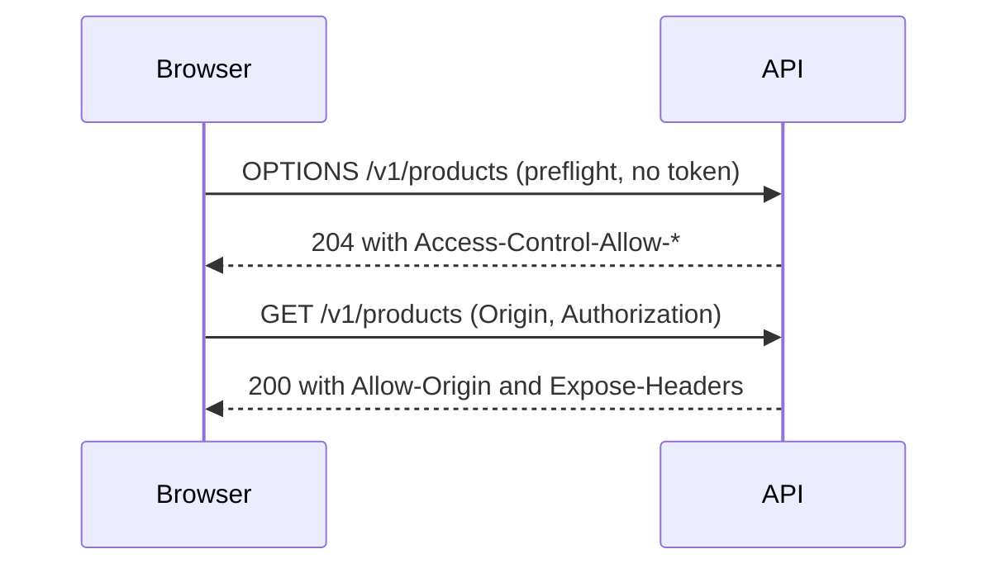

# 15 · CORS

CORS (Cross-Origin Resource Sharing) is a set of response headers that tells a browser which other web origins may call an API from JavaScript.

## Why it matters

- Without it, a React app on `http://localhost:5173` cannot read responses from an API on another origin. The browser blocks them.
- Too open (`*`, or echoing every `Origin`) lets script on any website call your API from a visitor's browser.
- If the preflight is sent through authentication or rate limiting, it fails, and the browser never sends the real request.

## How it works

Browsers enforce the same-origin policy. CORS, defined in the WHATWG Fetch Standard (there is no RFC), is the server's way to relax it. A request with a custom header such as `Authorization`, a method like `PUT`, or a JSON `Content-Type` is not "simple". The browser first sends a preflight: an `OPTIONS` request with `Origin`, `Access-Control-Request-Method` and `Access-Control-Request-Headers`. If the answer allows it, the browser sends the real request. CORS protects the person using the browser. It does not stop `curl`, so it never replaces authentication.

```http
OPTIONS /v1/products HTTP/1.1
Origin: http://localhost:5173
Access-Control-Request-Method: GET
Access-Control-Request-Headers: authorization

HTTP/1.1 204 No Content
Access-Control-Allow-Origin: http://localhost:5173
Access-Control-Allow-Methods: GET, POST, PUT, PATCH, DELETE
Access-Control-Max-Age: 600
Vary: Origin
```

## The rule in this repo

- Only origins in `CORS_ORIGINS` (default `http://localhost:5173`) are allowed; others get no `Access-Control-Allow-Origin`. Never send `Access-Control-Allow-Credentials` (bearer tokens, not cookies).
- Preflight: 204 or 200, the allowed methods and six request headers, `Access-Control-Max-Age: 600`. It skips authentication and rate limiting.
- Real request: `Access-Control-Allow-Origin`, `Vary: Origin`, and `Access-Control-Expose-Headers` for ETag, Link, Location, Retry-After, RateLimit-*, X-Request-Id and Idempotent-Replayed.

## Side by side

### Python · FastAPI
Starlette's `CORSMiddleware` does the work. It sits outside the routes, so preflights never reach authentication.

```python
app.add_middleware(
    CORSMiddleware,
    allow_origins=list(settings.cors_origins),
    allow_methods=["GET", "POST", "PUT", "PATCH", "DELETE"],
    allow_headers=CORS_ALLOWED_HEADERS,
    expose_headers=CORS_EXPOSED_HEADERS,
    allow_credentials=False,
    max_age=600,
)
```
[app/main.py](../../python-fastapi-aws/app/main.py#L78-L86)

### TypeScript · Express
A hand-written middleware (no `cors` package). It runs before authentication and ends a preflight with 204.

```typescript
if (!origin || !allowed.has(origin)) return next();
// …
res.setHeader('Access-Control-Allow-Origin', origin);
const isPreflight = req.method === 'OPTIONS' && req.get('Access-Control-Request-Method');
if (isPreflight) {
  res.setHeader('Access-Control-Allow-Methods', ALLOWED_METHODS);
  res.setHeader('Access-Control-Allow-Headers', ALLOWED_HEADERS);
  res.setHeader('Access-Control-Max-Age', '600');
  res.status(204).end();
```
[src/http/cors.ts](../../node-typescript-gcp/src/http/cors.ts#L14-L23)

### C# · ASP.NET Core
The built-in CORS policy, registered once and applied by `UseCors()`. It does not add `Vary: Origin` for an explicit origin list, so a small [VaryOriginMiddleware](../../dotnet-azure/src/ApiConcepts.Api/Http/VaryOriginMiddleware.cs#L5) adds it.

```csharp
services.AddOptions<CorsOptions>().Configure<AppSettings>((options, settings) =>
    options.AddDefaultPolicy(policy => policy
        .WithOrigins([.. settings.CorsOrigins])
        .WithMethods("GET", "POST", "PUT", "PATCH", "DELETE")
        .WithHeaders("Authorization", "Content-Type", "Idempotency-Key", "If-Match", "If-None-Match", "X-Request-Id")
        .WithExposedHeaders(
            "ETag", "Link", "Location", "Retry-After", "RateLimit-Limit", "RateLimit-Remaining",
            "RateLimit-Reset", "X-Request-Id", "Idempotent-Replayed")
        .SetPreflightMaxAge(TimeSpan.FromMinutes(10))));
```
[src/ApiConcepts.Api/Composition/ServiceRegistration.cs](../../dotnet-azure/src/ApiConcepts.Api/Composition/ServiceRegistration.cs#L73-L81)

## Try it

```bash
# Any stack works; 8001 is Python (8002 Node, 8003 .NET). Preflight from an allowed origin:
curl -si -X OPTIONS http://localhost:8001/v1/products \
  -H 'Origin: http://localhost:5173' \
  -H 'Access-Control-Request-Method: GET' \
  -H 'Access-Control-Request-Headers: authorization'

# A stranger gets no Access-Control-Allow-Origin
curl -si -X OPTIONS http://localhost:8001/v1/products -H 'Origin: https://evil.example' \
  -H 'Access-Control-Request-Method: GET' | grep -i '^access-control' || echo "no CORS headers"
# A real request: Allow-Origin, Expose-Headers and Vary
curl -si http://localhost:8001/health -H 'Origin: http://localhost:5173' | grep -i -E '^(access-control|vary)'
```

## In the cloud

- **AWS:** API Gateway HTTP APIs have a built-in CORS setting that answers preflights before Lambda runs. This repo's template leaves CORS to the app.
- **GCP:** nothing extra needed. Cloud Run passes headers through, so the app answers the preflight.
- **Azure:** App Service has a CORS setting, and API Management has a `cors` policy. Use one layer, not both, or headers get duplicated.

## Common mistakes

- **Wildcard plus credentials.** `Access-Control-Allow-Origin: *` is rejected by browsers when cookies or other credentials are sent. Echoing any origin is just as unsafe.
- **Forgetting `Vary: Origin`.** A shared cache can then serve the answer for one origin to another.
- **Not exposing headers.** JavaScript cannot read `ETag`, `Link` or `Retry-After` unless they are listed in `Access-Control-Expose-Headers`.

## Interview questions

<details><summary>What is a preflight request and when does a browser send one?</summary>
An <code>OPTIONS</code> request the browser sends before a cross-origin request that is not "simple": a custom header like <code>Authorization</code>, a method such as <code>PUT</code> or <code>DELETE</code>, or a JSON content type. The server's answer says whether the real request is allowed, and <code>Access-Control-Max-Age</code> lets the browser cache that answer.
</details>
<details><summary>Does CORS protect my API from attackers?</summary>
No. Only browsers enforce it, so <code>curl</code> or a server-side script ignores it. It stops other websites from reading responses in a visitor's browser. You still need authentication and authorization.
</details>
<details><summary>Why not just send <code>Access-Control-Allow-Origin: *</code>?</summary>
It is fine for a public API with no credentials. Browsers refuse it when credentials are involved, and for a private API an allowlist is safer. With an allowlist you echo the matching origin and add <code>Vary: Origin</code>.
</details>

← [previous](14-https.md) · [all concepts](../README.md) · [next](16-rest.md) →
