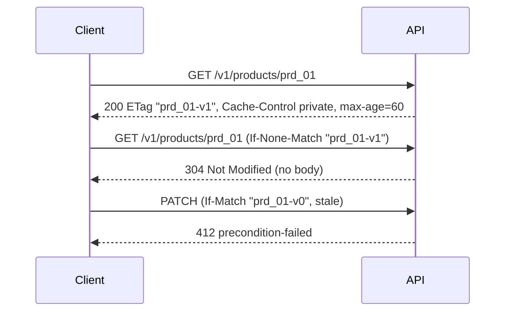

# 19 · Caching

Caching lets a client or a shared cache reuse a response, and lets it ask the server "has this changed?" so an unchanged answer costs almost nothing.

## Why it matters

- Without validators, every read downloads the full body again, even when nothing changed.
- Without `Cache-Control`, a proxy may store a private or fast-changing response and serve it to the wrong person or after it went stale.
- Without `If-Match`, two clients that edit the same record silently overwrite each other (the "lost update").

## How it works

HTTP caching is defined in RFC 9111, and the conditional requests in RFC 9110. The server marks a response with an `ETag` (a version label) and `Cache-Control` (who may store it and for how long). Later the client repeats the request with `If-None-Match: <etag>`. If the ETag still matches, the server sends `304 Not Modified` with no body, and the client reuses its copy. For writes, `If-Match: <etag>` means "only do this if the resource is still at this version". If it is not, the server answers `412 Precondition Failed`.

A strong ETag (`"prd_01-v1"`) means the bytes are identical. A weak one (`W/"..."`) means equivalent. `If-None-Match` uses weak comparison; `If-Match` uses strong.



```http
GET /v1/products/prd_01 HTTP/1.1
If-None-Match: "prd_01-v1"

HTTP/1.1 304 Not Modified
ETag: "prd_01-v1"
Cache-Control: private, max-age=60
```

## The rule in this repo

- `GET /v1/products/{id}`: strong `ETag: "<id>-v<version>"` and `Cache-Control: private, max-age=60`.
- `GET /v1/products`: weak `ETag: W/"<hash of the body>"` and `Cache-Control: private, max-age=30`.
- `If-None-Match` matching the ETag (or `*`) gives 304 with no body, and the same `ETag` and `Cache-Control`.
- `PUT`, `PATCH` and `DELETE` honour `If-Match`. Present and different from the current ETag gives 412 `precondition-failed`.
- Any response under `/v1`, `/graphql` or `/oauth` that sets no `Cache-Control` gets `no-store`.

## Side by side

### Python · FastAPI
The route compares `If-None-Match` using the helpers in [etag.py](../../python-fastapi-aws/app/web/etag.py#L6) and returns a bodiless `Response`.

```python
product = await _find(container, product_id)
etag = strong_etag(product.id, product.version)
if none_match_hit(request.headers.get("if-none-match"), etag):
    return Response(status_code=304, headers={"ETag": etag, "Cache-Control": PRODUCT_CACHE})
return _representation(product, headers={"Cache-Control": PRODUCT_CACHE})
```
[app/routes/products.py](../../python-fastapi-aws/app/routes/products.py#L88-L92)

### TypeScript · Express
One helper sets both headers, checks the condition and either ends with 304 or sends the body. [etag.ts](../../node-typescript-gcp/src/http/etag.ts#L4) holds the comparisons.

```typescript
res.setHeader('ETag', etag);
res.setHeader('Cache-Control', cacheControl);
if (noneMatchHits(req.get('If-None-Match'), etag)) {
  res.status(304).end();
  return;
}
```
[src/products/routes.ts](../../node-typescript-gcp/src/products/routes.ts#L24-L29)

### C# · ASP.NET Core
The handler sets the headers on the response and returns `Results.StatusCode(304)` when [ETags.IfNoneMatchHits](../../dotnet-azure/src/ApiConcepts.Api/Common/ETags.cs#L14) is true.

```csharp
var etag = ETags.ForProduct(product.Id, product.Version);
http.Response.Headers.ETag = etag;
http.Response.Headers.CacheControl = "private, max-age=60";
return ETags.IfNoneMatchHits(http.Request, etag) ? Results.StatusCode(304) : Results.Ok(product);
```
[src/ApiConcepts.Api/Endpoints/ProductEndpoints.cs](../../dotnet-azure/src/ApiConcepts.Api/Endpoints/ProductEndpoints.cs#L79-L82)

## Try it

```bash
# Any stack works; 8001 is Python.
TOKEN=$(curl -s -u writer:writer-secret -d grant_type=client_credentials http://localhost:8001/oauth/token | jq -r .access_token)

# 200 with an ETag, then 304 when we send it back
curl -si http://localhost:8001/v1/products/prd_01 -H "Authorization: Bearer $TOKEN" | grep -i -E '^(HTTP|etag|cache-control)'
curl -si http://localhost:8001/v1/products/prd_01 -H "Authorization: Bearer $TOKEN" -H 'If-None-Match: "prd_01-v1"' | head -n 1

# A stale If-Match gets 412
curl -s -X PATCH http://localhost:8001/v1/products/prd_01 -H "Authorization: Bearer $TOKEN" \
  -H 'Content-Type: application/json' -H 'If-Match: "prd_01-v99"' -d '{"priceCents":3000}' | jq '{status, type}'
```

## In the cloud

- **AWS:** CloudFront caches by `Cache-Control` at the edge, and API Gateway REST APIs (not HTTP APIs) have a stage cache. This template uses neither.
- **GCP:** Cloud CDN works with a load balancer in front of Cloud Run and respects `Cache-Control`. Nothing extra is needed for conditional requests.
- **Azure:** Azure Front Door caches at the edge, and API Management has cache policies. Conditional requests work with no extra setup.

## Common mistakes

- **Caching private data publicly.** Use `private` (or `no-store`) for anything tied to a user. `public` lets a CDN share it.
- **An ETag that does not change.** If the tag is not tied to the version or the exact bytes, clients keep stale data on a 304.
- **Skipping `If-Match` on writes.** Last write wins, and one client's edit vanishes without any error.

## Interview questions

<details><summary>What is the difference between <code>no-cache</code> and <code>no-store</code>?</summary>
<code>no-cache</code> allows storing but requires revalidation before reuse. <code>no-store</code> forbids storing the response at all. Use <code>no-store</code> for sensitive data, as this repo does by default.
</details>
<details><summary>How does an ETag save bandwidth?</summary>
The client sends the ETag back in <code>If-None-Match</code>. If it still matches, the server replies <code>304</code> with no body, so only headers cross the network.
</details>
<details><summary>How do you prevent lost updates in a REST API?</summary>
Return an ETag on reads and require <code>If-Match</code> on writes. If another client changed the resource, the tags differ and the server answers <code>412</code>, so the caller re-reads before saving.
</details>

← [previous](18-pagination.md) · [all concepts](../README.md) · [next](20-rate-limiting.md) →
