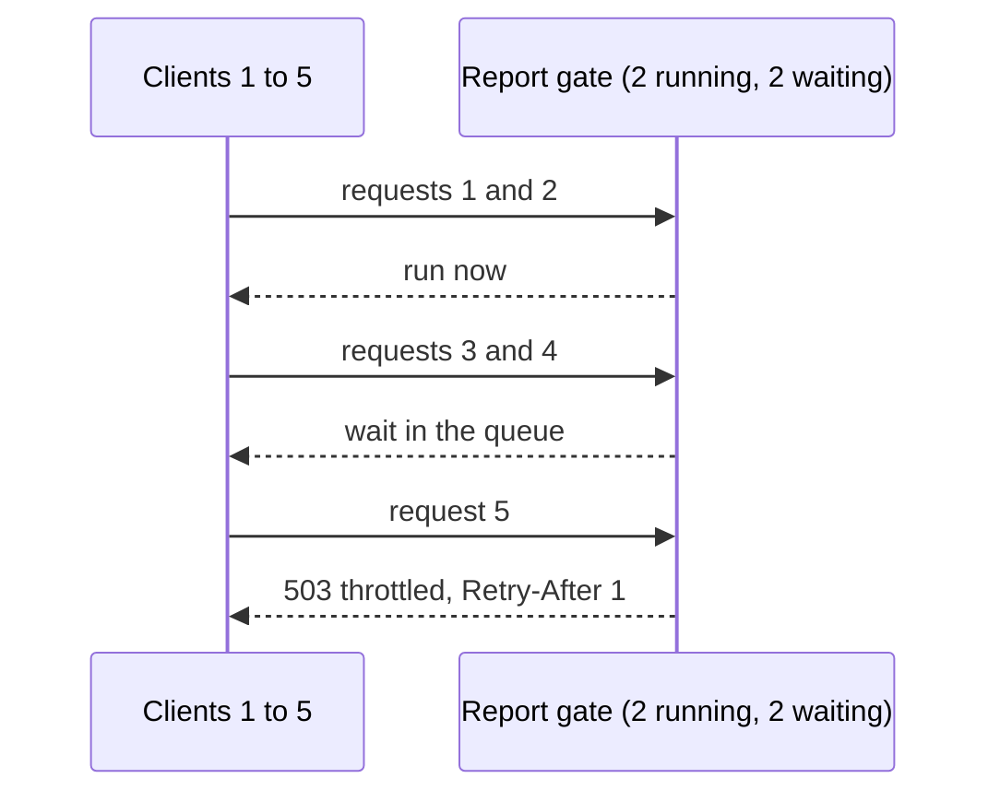

# 21 · Throttling

Throttling limits how much work the server does at once, and slows or rejects extra requests to keep the service alive.

## Why it matters

- An expensive endpoint (a report, an export) run by many callers at once can use all CPU, memory or database connections.
- An unbounded queue just moves the problem: requests wait longer than any client will, and memory grows until the process dies.
- Failing fast with a clear "busy, try again" is better for clients than a slow request that ends in a timeout.

## How it works

Rate limiting (concept 20) counts requests per client over time. Throttling counts work in progress, for every client together. A concurrency limit lets N jobs run. A small queue holds a few more, first in first out. When both are full, the server refuses new requests at once with `503 Service Unavailable` and `Retry-After`, which RFC 9110 defines for exactly this case.



```http
GET /v1/reports/sales?delayMs=1500 HTTP/1.1

HTTP/1.1 503 Service Unavailable
Content-Type: application/problem+json
Retry-After: 1

{"type":"/problems/throttled","title":"The server is busy, try again shortly","status":503, ...}
```

## The rule in this repo

- `GET /v1/reports/sales` runs at most 2 reports at once. At most 2 more wait in a FIFO queue.
- A request that finds 2 running and 2 waiting gets `503` `throttled` with `Retry-After: 1`, immediately.
- The report timeout (concept 24) starts when a job gets a slot. Queue time does not count.

## Side by side

### Python · FastAPI
`ConcurrencyGate` wraps `asyncio.Semaphore(2)`, which wakes waiters in FIFO order, plus a counter of waiters so it can refuse at once.

```python
if self._slots.locked():
    if self._waiting >= self._max_waiting:
        raise Problem(
            "throttled",
            "Too many reports are running. Try again shortly.",
            headers={"Retry-After": "1"},
        )
    self._waiting += 1
```
[app/services/throttle.py](../../python-fastapi-aws/app/services/throttle.py#L22-L29)

### TypeScript · Express
A hand-written throttle with a `running` count and an array of waiting resolvers. A slot passes straight to the oldest waiter.

```typescript
if (this.running >= this.maxRunning) {
  if (this.waiting.length >= this.maxWaiting) throw new ThrottleFullError();
  await new Promise<void>((resolve) => this.waiting.push(resolve)); // the slot is handed over by release()
} else {
  this.running++;
}
```
[src/limits/throttle.ts](../../node-typescript-gcp/src/limits/throttle.ts#L24-L29)

### C# · ASP.NET Core
The built-in `ConcurrencyLimiter` policy gives running slots and a queue with no custom code. The report endpoint opts in with [RequireRateLimiting](../../dotnet-azure/src/ApiConcepts.Api/Endpoints/ReportEndpoints.cs#L18), and `OnRejected` writes the 503.

```csharp
options.AddConcurrencyLimiter(ReportsPolicy, limiter =>
{
    limiter.PermitLimit = 2;
    limiter.QueueLimit = 2;
    limiter.QueueProcessingOrder = QueueProcessingOrder.OldestFirst;
});
```
[src/ApiConcepts.Api/RateLimiting/RateLimitSetup.cs](../../dotnet-azure/src/ApiConcepts.Api/RateLimiting/RateLimitSetup.cs#L20-L25)

## Try it

```bash
# Any stack works; 8001 is Python.
TOKEN=$(curl -s -u reader:reader-secret -d grant_type=client_credentials http://localhost:8001/oauth/token | jq -r .access_token)

# Five reports at once: four 200s and one 503 (order varies)
for i in 1 2 3 4 5; do
  curl -s -o /dev/null -w '%{http_code} after %{time_total}s\n' \
    "http://localhost:8001/v1/reports/sales?delayMs=1500" -H "Authorization: Bearer $TOKEN" &
done
wait
```

## In the cloud

- **AWS:** API Gateway stage throttling (`ThrottlingRateLimit` and `ThrottlingBurstLimit`), set in this repo's [template.yaml](../../python-fastapi-aws/infra/aws/template.yaml#L80). Lambda reserved concurrency caps parallel executions.
- **GCP:** Cloud Run `--concurrency` (requests per instance, set to 80 in [deploy.sh](../../node-typescript-gcp/infra/gcp/deploy.sh#L64)) and `--max-instances` bound the total load.
- **Azure:** API Management has a `limit-concurrency` policy, and App Service plans cap how far you scale out.

## Common mistakes

- **An unbounded queue.** It hides overload until memory runs out. Bound it and reject the rest.
- **503 with no `Retry-After`.** Clients cannot tell when to come back and tend to hammer the server.
- **One limit for all work.** A cheap health check should not wait behind slow reports. Throttle the expensive routes only.

## Interview questions

<details><summary>What is load shedding?</summary>
Refusing some work on purpose so the rest stays healthy. Here the fifth report request is rejected right away, which protects the four that are already accepted.
</details>
<details><summary>Why return 503 and not 429 for a full queue?</summary>
429 means "you, specifically, sent too many". 503 means "the service cannot take this right now", which is true for any caller. Both can carry <code>Retry-After</code>.
</details>
<details><summary>How is a concurrency limit different from a rate limit?</summary>
A rate limit counts requests per time. A concurrency limit counts requests in flight. Slow requests hit a concurrency limit even when the request rate is low.
</details>

← [previous](20-rate-limiting.md) · [all concepts](../README.md) · [next](22-idempotency.md) →
