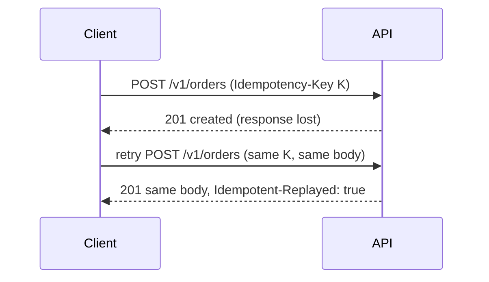

# 22 · Idempotency

An idempotent operation gives the same result no matter how many times you send it, so a retry after a lost response cannot do the work twice.

## Why it matters

- A client sends `POST /v1/orders`, the connection drops before the reply arrives, and it retries. Without protection, the customer gets two orders and two charges.
- `GET`, `PUT` and `DELETE` are idempotent by definition (RFC 9110). `POST` is not, so it needs help.
- Two retries that arrive at the same time can both pass a naive "have I seen this key" check.

## How it works

The client generates a unique `Idempotency-Key` (a UUID) for each logical operation and sends the same key on every retry. The server remembers the first result for that key. If the same key arrives with the same body, the server returns the stored response instead of creating another order. The key plus a hash of the body also catches mistakes: the same key with a different body is an error. The header is described in an IETF draft (not yet an RFC), widely used by payment APIs.



```http
POST /v1/orders HTTP/1.1
Idempotency-Key: 5b0c7e1e-3a52-4d7f-9a41-2f9a6a1c0d11
Content-Type: application/json

{"items":[{"productId":"prd_01","quantity":2}]}

HTTP/1.1 201 Created
Location: /v1/orders/ord_1a2b3c4d5e6f
Idempotent-Replayed: true
```

## The rule in this repo

- `POST /v1/orders` needs `Idempotency-Key` of 1 to 255 characters, else 400 `idempotency-key-required`.
- The key is scoped to the client and kept for 24 hours. Only a 201 is stored (status, body, `Location`).
- Same key and byte-identical body (compared by SHA-256): the stored 201 again, with `Idempotent-Replayed: true`. No new order and no new webhook event.
- Same key, different body: 422 `idempotency-key-reused`. Same key while the first request is still running: 409 `idempotency-key-in-progress`.
- The first response does not carry `Idempotent-Replayed`. A failed first attempt releases the key.

## Side by side

### Python · FastAPI
`begin` returns one of four small classes (start, replay, in progress, reused) and the route handles each with `match`. The claim is atomic because `begin` has no `await`.

```python
match outcome:
    case Replay(stored):
        return Response(
            stored.body,
            status_code=stored.status,
            media_type="application/json",
            headers={"Location": stored.location, "Idempotent-Replayed": "true"},
        )
```
[app/routes/orders.py](../../python-fastapi-aws/app/routes/orders.py#L70-L77)

### TypeScript · Express
`begin` returns a tagged union (`kind: 'new' | 'replay' | 'in-progress' | 'reused'`). It is synchronous so two claims cannot race.

```typescript
if (existing && existing.expiresAt > this.clock()) {
  if (existing.fingerprint !== fingerprint) return { kind: 'reused' };
  return existing.response ? { kind: 'replay', response: existing.response } : { kind: 'in-progress' };
}
this.entries.set(id, { fingerprint, expiresAt: this.clock() + IDEMPOTENCY_TTL_MS });
return { kind: 'new' };
```
[src/idempotency.ts](../../node-typescript-gcp/src/idempotency.ts#L36-L41)

### C# · ASP.NET Core
The endpoint switches on the decision record returned by [IdempotencyStore.Begin](../../dotnet-azure/src/ApiConcepts.Api/Orders/IdempotencyStore.cs#L38).

```csharp
case IdempotencyDecision.Replay replay:
    return Created(replay.Response, replayed: true);
case IdempotencyDecision.InProgress:
    throw new ProblemException(
        ProblemType.IdempotencyKeyInProgress, "A request with this Idempotency-Key is still being processed.");
```
[src/ApiConcepts.Api/Endpoints/OrderEndpoints.cs](../../dotnet-azure/src/ApiConcepts.Api/Endpoints/OrderEndpoints.cs#L62-L66)

## Try it

```bash
# Any stack works; 8001 is Python. The writer client can create orders.
TOKEN=$(curl -s -u writer:writer-secret -d grant_type=client_credentials http://localhost:8001/oauth/token | jq -r .access_token)
KEY=$(uuidgen)
BODY='{"items":[{"productId":"prd_01","quantity":2}]}'

# Twice with the same key: same order id, second one has Idempotent-Replayed: true
for i in 1 2; do
  curl -si -X POST http://localhost:8001/v1/orders -H "Authorization: Bearer $TOKEN" \
    -H 'Content-Type: application/json' -H "Idempotency-Key: $KEY" -d "$BODY" | grep -i -E '^(HTTP|location|idempotent-replayed)'
done

# Same key, different body: 422
curl -s -X POST http://localhost:8001/v1/orders -H "Authorization: Bearer $TOKEN" \
  -H 'Content-Type: application/json' -H "Idempotency-Key: $KEY" -d '{"items":[{"productId":"prd_02","quantity":1}]}' | jq .type
```

## In the cloud

- **AWS:** Powertools for AWS Lambda has an idempotency utility that stores keys in DynamoDB with a TTL. The managed store is DynamoDB.
- **GCP:** nothing built in at the edge. Store keys in Firestore or Memorystore (Redis) with an expiry.
- **Azure:** nothing built in at the edge. Store keys in Azure Cache for Redis or Cosmos DB with a TTL.

## Common mistakes

- **Checking and storing in two steps.** Two simultaneous retries both pass the check. Claim the key atomically.
- **Not checking the body.** The same key with different data should be an error, not a silent replay of the old result.
- **Per-instance memory in production.** A retry that lands on another instance sees no key. Use a shared store.

## Interview questions

<details><summary>Which HTTP methods are idempotent, and is POST?</summary>
GET, HEAD, PUT, DELETE and OPTIONS are idempotent in RFC 9110 (GET, HEAD and OPTIONS are also safe). POST is not, which is why an <code>Idempotency-Key</code> is needed to retry it safely.
</details>
<details><summary>What should the server do if the same key arrives while the first request is still running?</summary>
Not start a second run. Return 409 here, or wait for the first to finish. The client can retry shortly after and then receive the stored result.
</details>
<details><summary>Why is the key tied to the client as well as the request body?</summary>
So one client cannot replay or collide with another client's keys. The scope is (client, key), and the body hash detects reuse of a key for a different request.
</details>

← [previous](21-throttling.md) · [all concepts](../README.md) · [next](23-retries.md) →
