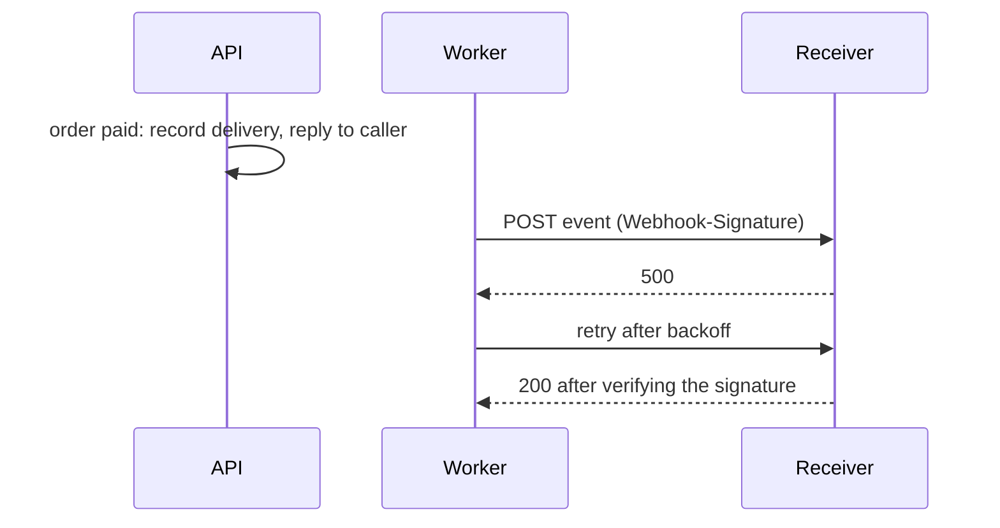

# 26 · Webhooks

A webhook is an HTTP request the API sends to a URL you registered, to tell you that something happened, instead of you polling for it.

## Why it matters

- Polling wastes calls and still finds out late. A webhook arrives within moments of the event.
- A receiver cannot trust a bare `POST`. Without a signature, anyone who learns the URL can fake an event.
- If the API called receivers inside the request, one slow receiver would slow every order. Delivery has to happen in the background.

## How it works

A client subscribes with a URL and a list of event types, and gets a secret. When an event happens, the API records a delivery per matching subscription, answers its own caller right away, and a background worker POSTs the event. The worker signs `<timestamp>.<raw body>` with HMAC-SHA256 (RFC 2104) using the secret. The receiver recomputes the signature, checks the timestamp is recent, and answers 2xx. Any other result is retried with backoff (concept 25). Delivery is at least once, so receivers must tolerate duplicates.


```http
POST /hook HTTP/1.1
Content-Type: application/json
Webhook-Id: evt_9a8b7c6d5e4f
Webhook-Timestamp: 1767225600
Webhook-Signature: v1=<64 lowercase hex characters>

{"id":"evt_9a8b7c6d5e4f","type":"order.paid","createdAt":"2026-01-01T00:00:00.000Z","data":{"order":{...}}}
```

## The rule in this repo

- `POST /v1/webhooks` (admin) with `url` and `events` (`order.created`, `order.paid`) returns the subscription with its `secret`.
- Delivery runs in the background and never blocks the API response. A 2xx within 5 s is success.
- Signature: `v1=` plus the lowercase hex HMAC-SHA256 of `<timestamp>.<raw body>`, keyed by the whole secret (including `whsec_`).
- Failures retry with backoff up to `WEBHOOK_MAX_ATTEMPTS`; `GET /v1/webhooks/{id}/deliveries` shows status and attempts. The verify helper compares in constant time and rejects timestamps over 300 s old.

## Side by side

### Python · FastAPI
`sign` and `verify_signature` use `hmac`. Delivery runs in [asyncio tasks](../../python-fastapi-aws/app/services/webhooks.py#L53) started by `WebhookDispatcher.publish`.

```python
def sign(secret: str, timestamp: int | str, body: bytes) -> str:
    """`v1=<hex>` over `<timestamp>.<raw body>`, keyed with the whole secret including `whsec_`."""
    message = f"{timestamp}.".encode() + body
    digest = hmac.new(secret.encode(), message, hashlib.sha256).hexdigest()
    return f"v1={digest}"
    # …
    expected = sign(secret, timestamp, body)
    if not any(hmac.compare_digest(expected, candidate) for candidate in signature.split()):
        raise InvalidSignature("signature does not match")
```
[app/web/signature.py](../../python-fastapi-aws/app/web/signature.py#L15-L45)

### TypeScript · Express
`node:crypto` provides `createHmac` and `timingSafeEqual`. [WebhookDispatcher](../../node-typescript-gcp/src/webhooks/dispatcher.ts#L23) delivers from a promise that the request never awaits.

```typescript
export function signWebhook(secret: string, timestamp: number, rawBody: string): string {
  return `v1=${createHmac('sha256', secret).update(`${timestamp}.${rawBody}`).digest('hex')}`;
}
  // …
  const expected = Buffer.from(signWebhook(secret, sentAt, rawBody));
  return signature.split(/\s+/).some((candidate) => {
    const received = Buffer.from(candidate);
    return received.length === expected.length && timingSafeEqual(received, expected);
  });
```
[src/webhooks/signature.ts](../../node-typescript-gcp/src/webhooks/signature.ts#L7-L34)

### C# · ASP.NET Core
Publishing writes to a `Channel<T>`; a [BackgroundService](../../dotnet-azure/src/ApiConcepts.Api/Webhooks/WebhookWorker.cs#L8) delivers. The receiver helper lives in the client library.

```csharp
if (!long.TryParse(timestampHeader, out var seconds) ||
    (now - DateTimeOffset.FromUnixTimeSeconds(seconds)).Duration() > Tolerance ||
    !signatureHeader.StartsWith("v1=", StringComparison.Ordinal))
{
    return false;
}
// …
var message = Encoding.UTF8.GetBytes($"{seconds}.").Concat(rawBody).ToArray();
var expected = HMACSHA256.HashData(Encoding.UTF8.GetBytes(secret), message);
    // …
    return CryptographicOperations.FixedTimeEquals(expected, Convert.FromHexString(signatureHeader[3..]));
```
[src/ApiConcepts.Client/WebhookSignature.cs](../../dotnet-azure/src/ApiConcepts.Client/WebhookSignature.cs#L17-L28)

## Try it

```bash
# Any stack works; 8001 is Python. First, in another terminal: python3 -m http.server 9000
# (it answers 501 to POST, so deliveries fail and you can watch the retries)
tok() { curl -s -u "$1" -d grant_type=client_credentials http://localhost:8001/oauth/token | jq -r .access_token; }
ADMIN=$(tok admin:admin-secret); WRITER=$(tok writer:writer-secret)
ID=$(curl -s -X POST http://localhost:8001/v1/webhooks -H "Authorization: Bearer $ADMIN" -H 'Content-Type: application/json' \
  -d '{"url":"http://localhost:9000/hook","events":["order.created"]}' | jq -r .id)
curl -s -o /dev/null -X POST http://localhost:8001/v1/orders -H "Authorization: Bearer $WRITER" -H 'Content-Type: application/json' \
  -H "Idempotency-Key: $(uuidgen)" -d '{"items":[{"productId":"prd_01","quantity":1}]}'
sleep 3; curl -s http://localhost:8001/v1/webhooks/$ID/deliveries -H "Authorization: Bearer $ADMIN" | jq '.data[] | {status, attempts, lastStatusCode}'
```

## In the cloud

- **AWS:** EventBridge API destinations send events to HTTPS endpoints with retries. For your own sender, put SQS between the API and a worker Lambda, as this repo's README suggests.
- **GCP:** Pub/Sub push subscriptions POST to an HTTPS endpoint with a retry policy and dead-letter topic. Cloud Tasks can also call HTTP targets.
- **Azure:** Event Grid delivers to webhook endpoints with retries and dead-lettering, and Service Bus can feed a worker.

## Common mistakes

- **Verifying parsed JSON instead of the raw body.** Re-serializing changes bytes and breaks the signature.
- **Skipping the timestamp check or using `==`.** That allows replays and timing attacks. Use a constant-time compare.
- **Doing slow work before answering.** Reply 2xx quickly, then process, and dedupe on `Webhook-Id` because deliveries can repeat.

## Interview questions

<details><summary>How does a receiver know a webhook is genuine?</summary>
It recomputes the HMAC of the timestamp and raw body with the shared secret and compares it to the signature in constant time. Only the API and the subscriber know the secret.
</details>
<details><summary>Why is the timestamp part of the signed message?</summary>
So an attacker cannot capture one valid delivery and replay it later. The receiver rejects timestamps outside a short window, here 300 seconds.
</details>
<details><summary>Are webhooks delivered exactly once?</summary>
No, at least once. A retry after a lost 2xx sends the event again, so receivers must be idempotent, for example by remembering the `Webhook-Id` values they have processed.
</details>

← [previous](25-exponential-backoff.md) · [all concepts](../README.md) · [next](27-error-handling.md) →
